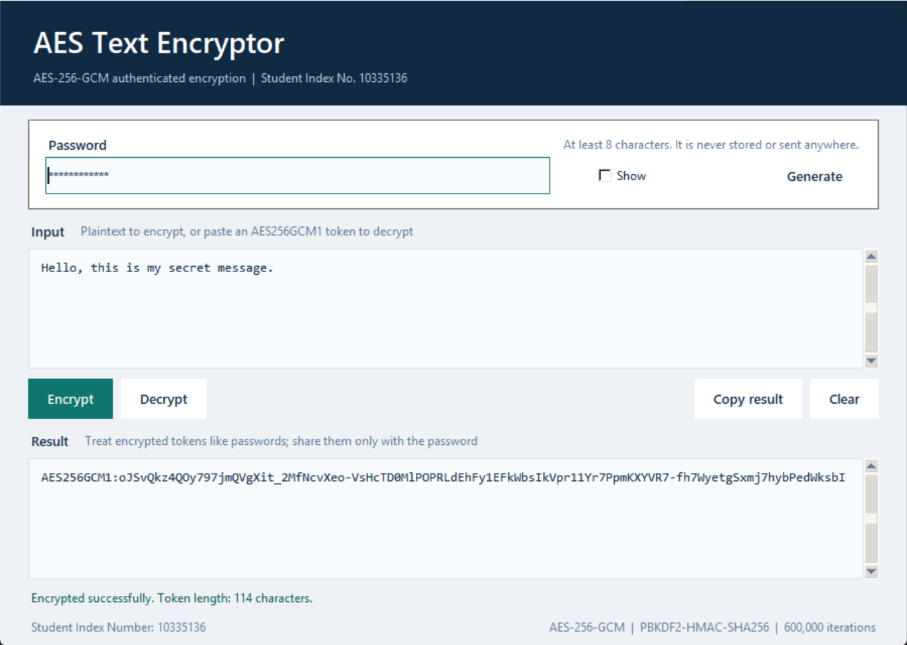

# AES Text Encryptor

> **Student Index Number: `10335136`**

A Python desktop and command-line application that **encrypts and decrypts text**
using **AES-256-GCM**, one of the encryption algorithms covered in class.

The project includes a command-line interface, an interactive menu, a Tkinter
graphical interface, automated tests, and a GitHub Actions workflow.

| Project detail | Value |
| --- | --- |
| **Student index number** | **10335136** |
| Language | Python 3.9+ |
| Encryption algorithm | **AES-256-GCM** (Advanced Encryption Standard) |
| Key derivation | PBKDF2-HMAC-SHA256, 600,000 iterations |
| Interfaces | CLI, interactive menu, Tkinter GUI |
| Automated tests | 16 unit tests |

---

## 1. What the program does

The application takes a piece of text and a password, derives a 256-bit key from
the password, and encrypts the text with AES-256-GCM. The result is a compact,
copyable token that starts with `AES256GCM1:`. The same password is required to
decrypt the token back into the original text.

Features:

- Encrypt and decrypt any Unicode text, including emoji and multiple lines.
- Password is hidden while typing and is **never stored**.
- Fresh random salt and nonce for every encryption.
- Authentication prevents wrong-password and tampering attacks.
- Command-line mode for quick use and automation.
- Interactive menu for classroom demonstrations.
- Desktop GUI with password generator, show/hide password, and copy button.
- 16 automated tests covering round trips, tampering, malformed tokens, and
  password rules.
- GitHub Actions workflow that runs the tests on Python 3.9, 3.11, and 3.13.

---

## 2. Why AES-256-GCM?

AES (Advanced Encryption Standard) is a symmetric block cipher and is the
algorithm selected for this project.

| Algorithm | Why it was or was not selected |
| --- | --- |
| **AES-256-GCM** | **Selected.** Standard, fast, available in Python's `cryptography` library, and provides both confidentiality and integrity. |
| DES | Obsolete: its 56-bit key is too small for modern security. |
| Caesar cipher | Educational only: it is broken almost instantly by brute force. |
| RSA | Useful for key exchange and signatures, but slow and awkward for encrypting arbitrary-length text directly. |

GCM (Galois/Counter Mode) is an authenticated mode of AES. It encrypts the text
and also produces an authentication tag. During decryption, the tag is checked
before any plaintext is returned. If the password is wrong or even one bit of
the token has been changed, decryption fails with a clear error.

---

## 3. How the encryption works

```text
Password ──► PBKDF2-HMAC-SHA256 (600,000 iterations + random salt)
                              │
                              ▼
                       256-bit AES key
                              │
Text ──────────────────► AES-256-GCM (random 96-bit nonce)
                              │
                              ▼
             salt (16 bytes) │ nonce (12 bytes) │ ciphertext │ tag (16 bytes)
                              │
                              ▼
                    base64url encoding
                              │
                              ▼
                 AES256GCM1:<printable token>
```

Step by step:

1. A random **16-byte salt** is generated with the operating system's
   cryptographically secure random generator.
2. PBKDF2-HMAC-SHA256 derives a **32-byte (256-bit) key** from the password and
   salt. The 600,000 iterations make password guessing expensive.
3. A random **12-byte nonce** is generated. A new nonce is used for every
   encryption, which is required for AES-GCM security.
4. AES-256-GCM encrypts the UTF-8 encoded text and appends a **16-byte
   authentication tag**.
5. Salt, nonce, ciphertext, and tag are encoded with URL-safe base64 and
   prefixed with `AES256GCM1:`.

The token layout is:

```text
AES256GCM1:  base64url( salt[16] || nonce[12] || ciphertext || tag[16] )
```

The salt and nonce are not secret. They are stored with the ciphertext so that
decryption can derive the same key. The password is never written to the token
or to disk.

---

## 4. Installation

### Requirements

- Python **3.9 or newer**
- `pip`
- Tkinter for the GUI (included with the standard Windows and macOS Python
  installers; on some Linux distributions it is a separate package)

### Windows (PowerShell)

```powershell
git clone https://github.com/YOUR-USERNAME/aes-text-encryptor.git
cd aes-text-encryptor

python -m venv .venv
.\.venv\Scripts\Activate.ps1

python -m pip install --upgrade pip
python -m pip install -r requirements.txt
```

If PowerShell blocks the activation script, run this once in the current
terminal and activate again:

```powershell
Set-ExecutionPolicy -Scope Process -ExecutionPolicy Bypass
```

### macOS / Linux

```bash
git clone https://github.com/YOUR-USERNAME/aes-text-encryptor.git
cd aes-text-encryptor

python3 -m venv .venv
source .venv/bin/activate

python -m pip install --upgrade pip
python -m pip install -r requirements.txt
```

If Tkinter is missing on Linux, install it with your package manager, for
example:

```bash
sudo apt install python3-tk
```

---

## 5. Command-line usage

### Encrypt text

```console
$ python main.py encrypt "Hello, this is my secret message."
Password:
Confirm password:
AES256GCM1:Nl2187rs0TOUUw8R9VifySdxtaWyECXI4T5jaUSGIXXY5rmn2UaGrB6vkeJ4Xk8VqNhPZgdZHJcKIL3D2UGraznqR7Y2bdTrgAeQnu8
```

### Decrypt text

```console
$ python main.py decrypt "AES256GCM1:Nl2187rs0TOUUw8R9VifySdxtaWyECXI4T5jaUSGIXXY5rmn2UaGrB6vkeJ4Xk8VqNhPZgdZHJcKIL3D2UGraznqR7Y2bdTrgAeQnu8"
Password:
Hello, this is my secret message.
```

The example token above was created with the password `DemoPass123!`. It is a
sample only; use your own password for real messages.

> Always put the token in quotes. It contains characters such as `:` and `_`
> that the shell may interpret.

### Save the result to a file

```console
$ python main.py encrypt "Report is ready." -o message.enc
$ python main.py decrypt "AES256GCM1:..." -o message.txt
```

The file is written as UTF-8. The plaintext is written exactly as entered.

### Use in a script

`--password-stdin` reads the password from standard input instead of showing a
prompt. This avoids putting the password in the command line or shell history.

PowerShell:

```powershell
"DemoPass123!" | python main.py encrypt "Automated message" --password-stdin
```

macOS / Linux:

```bash
printf '%s\n' 'DemoPass123!' | python main.py encrypt "Automated message" --password-stdin
```

### Interactive menu

```console
$ python main.py menu
```

```text
============================================================
  AES Text Encryptor
  Student Index Number: 10335136
  Algorithm: AES-256-GCM + PBKDF2-HMAC-SHA256
============================================================
1) Encrypt text
2) Decrypt token
3) Exit

Choose an option [1-3]:
```

### Help and version

```console
$ python main.py --help
$ python main.py --version
```

---

## 6. Desktop GUI

Launch the graphical interface with either command:

```console
$ python gui.py
```

```console
$ python main.py gui
```



The window provides:

- A password field with **Show / Hide** and a **Generate** button.
- A large input area for plaintext or an encrypted token.
- **Encrypt** and **Decrypt** buttons.
- **Copy result** and **Clear** buttons.
- A status line showing success or a helpful error.

Keyboard shortcuts:

| Shortcut | Action |
| --- | --- |
| `Ctrl + Enter` | Encrypt |
| `Ctrl + Shift + Enter` | Decrypt |
| `Esc` | Clear the form |

The GUI uses the same `aes_text_cipher` module as the command-line version, so
both interfaces produce compatible tokens.

---

## 7. Running the tests

The test suite uses Python's built-in `unittest`, so no extra test dependency is
needed.

```console
$ python -m unittest discover -s tests -v
```

Expected result:

```text
Ran 16 tests in ...s

OK
```

The tests verify:

- ASCII, Unicode, multiline, and empty-text round trips
- That a fresh salt and nonce are used each time
- That the same message and password produce different tokens
- That a wrong password is rejected
- That modified salt, nonce, or authentication tag is rejected
- That malformed and truncated tokens are rejected
- Password length rules and Unicode passwords
- That the token uses URL-safe characters only

The workflow in `.github/workflows/tests.yml` runs the same tests automatically
on every push and pull request.

---

## 8. Project structure

```text
aes-text-encryptor/
├── .github/
│   └── workflows/
│       └── tests.yml           # GitHub Actions test workflow
├── docs/
│   └── screenshot.png          # Screenshot used in this README
├── tests/
│   ├── __init__.py
│   └── test_cipher.py          # 16 unit tests
├── aes_text_cipher.py          # AES-256-GCM core logic
├── gui.py                      # Tkinter desktop interface
├── main.py                     # Command-line interface and menu
├── requirements.txt            # cryptography dependency
├── README.md                   # Project documentation (index 10335136)
├── LICENSE                     # MIT license
├── .gitattributes              # Consistent LF line endings
└── .gitignore
```

### Core API

If you want to use the cipher in another Python program:

```python
from aes_text_cipher import decrypt_text, encrypt_text

password = "a-strong-password"
token = encrypt_text("Hello, world!", password)
print(token)

original = decrypt_text(token, password)
print(original)  # Hello, world!
```

`encrypt_text()` and `decrypt_text()` raise `CipherError` subclasses for invalid
tokens, wrong passwords, and weak passwords.

---

## 9. Publish to GitHub and submit

A local Git repository has already been initialised with the project files and a
commit. To publish it:

1. Sign in to GitHub and create a **new empty repository** named
   `aes-text-encryptor`. Do **not** add a README, `.gitignore`, or license,
   because those files already exist locally.
2. In this project folder, connect the local repository to GitHub and push:

   ```console
   $ git remote add origin https://github.com/YOUR-USERNAME/aes-text-encryptor.git
   $ git branch -M main
   $ git push -u origin main
   ```

3. Open the repository in your browser and confirm that `README.md` displays
   **10335136**.
4. Copy the repository URL, for example:

   ```text
   https://github.com/YOUR-USERNAME/aes-text-encryptor
   ```

5. Paste that URL into the lecturer's submission form.

If you use GitHub Desktop instead, choose **File → Add local repository**, select
this folder, publish it, and then copy the repository URL.

---

## 10. Security notes and limitations

This is a university project, not a formally audited security product.

- **Use a strong, unique password.** The minimum is 8 characters, but 12 or more
  random characters is much better. The security of the token depends on the
  password.
- **There is no password recovery.** If the password is lost, the message cannot
  be decrypted.
- **The password is never stored.** It exists only in memory while the program
  is running.
- **A wrong password and a modified token look the same.** Both fail
  authentication, and the program deliberately does not reveal which one
  happened.
- **Token length reveals approximate message length.** Encryption hides the
  contents but not the size of the message.
- **Local device security still matters.** Malware or a keylogger can capture a
  password before encryption begins.
- **GCM nonces must never repeat under the same key.** This implementation uses a
  fresh random 96-bit nonce for every encryption and a fresh salt for every
  password-derived key.
- For production systems, use a dedicated key-management service, a
  memory-hard password KDF such as Argon2id, and a reviewed cryptography
  library.

---

## 11. License

This project is released under the [MIT License](LICENSE).

**Student Index Number: 10335136**
